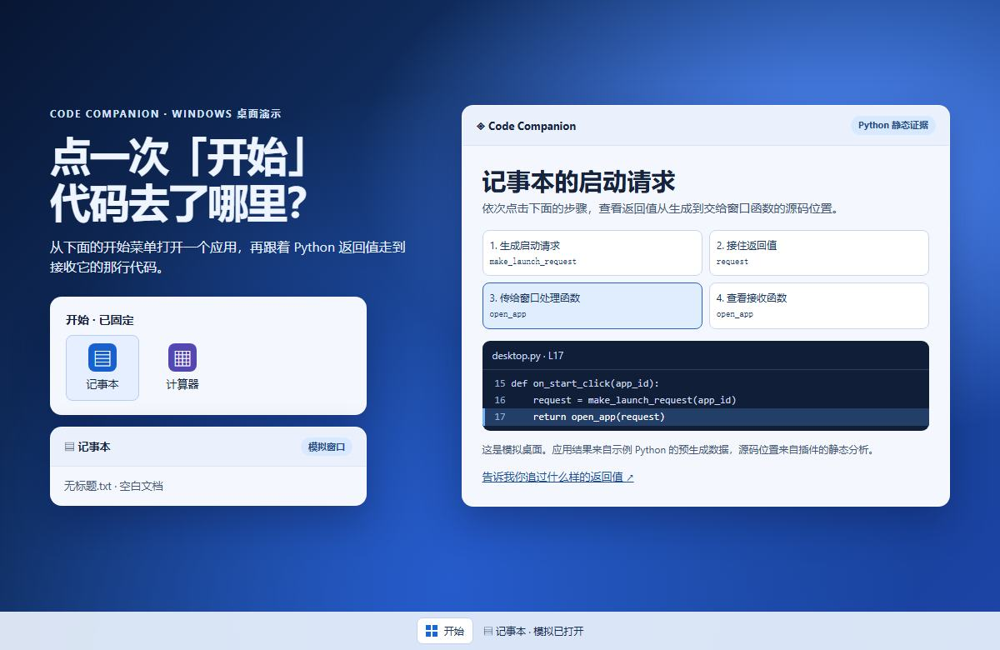

# Code Companion Structure Map

[简体中文](README.md) | **English**

**Where does a Python function's return value go?** Code Companion links the return statement, the caller that receives the value, and its later uses in VS Code. Every step points back to the source.

## Try the Windows desktop demo

Click the image, choose Notepad or Calculator, and trace the launch request to its Python source in 30 seconds.

**[Play online](https://greenpoem33-cloud.github.io/code-companion-structure-map/demo/)** · [Offline HTML](demo/index.html) (select **Download raw file**).

Follow the four steps here on GitHub

1. [Create the request](demo/desktop.py#L7-L8) · `make_launch_request()` returns a dictionary with the app ID and window configuration.
2. [Receive the value](demo/desktop.py#L15-L16) · `on_start_click()` saves the result in `request`.
3. [Pass it to the window handler](demo/desktop.py#L17) · `request` is passed to `open_app()`.
4. [Read the window configuration](demo/desktop.py#L11-L12) · `open_app()` returns `request['window']`.

## Try it in VS Code

**[Download the 0.27.23 preview VSIX](https://github.com/greenpoem33-cloud/code-companion-structure-map/releases/download/v0.27.23-preview.1/code-companion-structure-map-0.27.23.vsix)** · [Release notes](https://github.com/greenpoem33-cloud/code-companion-structure-map/releases/tag/v0.27.23-preview.1)

1. In the VS Code Extensions menu, select **Install from VSIX…**, then reload the window.
2. Open [desktop.py](demo/desktop.py) and select **Download raw file**, open its folder in VS Code, and open the Python file.
3. Right-click inside `make_launch_request()` and choose **Code Companion: 追踪返回值去向** (Trace return value). Select **Open use site** next to the `open_app` entry.

This command reads saved source and requires no model configuration. See [Installation](docs/INSTALL.en.md) for requirements and optional AI features.

The preview also includes project maps, source-linked call chains, and a structural change summary before applying edits. Static relationships, test observations, and unresolved links are displayed separately.

## Feedback

First impressions are welcome. **When did you last trace a function's return value, how did you do it, and what took the most time?** [Share feedback](https://github.com/greenpoem33-cloud/code-companion-structure-map/issues/new?template=desktop-feedback.md) · [Report a bug](https://github.com/greenpoem33-cloud/code-companion-structure-map/issues/new/choose)

This public repository distributes preview packages, documentation, and the standalone demo example. The extension development source and internal test projects remain private. No open-source license is granted with this preview. Please keep credentials and private code out of feedback.

[Current scope](docs/KNOWN_ISSUES.en.md) · [Data and credentials](docs/PRIVACY.en.md) · [Validation](docs/TEST_RESULTS.en.md)
