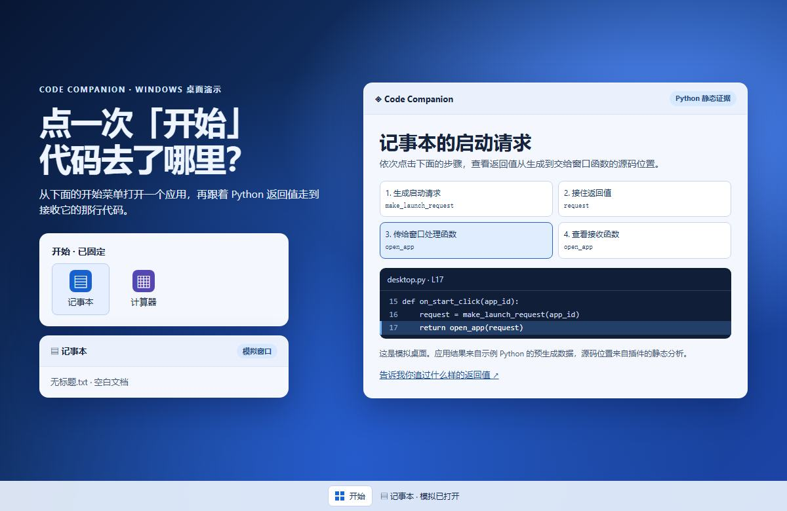

# Code Companion Structure Map

**简体中文** | [English](README.en.md)

**一个 Python 函数返回的数据，接下来去了哪里？** Code Companion 在 VS Code 里把返回语句、调用方接收位置和后续使用连接起来，每一步都能回到源码。

## 30 秒试玩 Windows 桌面

打开模拟桌面的「开始」菜单，点 **记事本** 或 **计算器**。跟着启动请求从 `make_launch_request()` 返回，看到 `on_start_click()` 接收它，再传给 `open_app()`。点任何一步，右侧高亮对应的 Python 源码。

**[点击图片或点这里，在线试玩](https://greenpoem33-cloud.github.io/code-companion-structure-map/demo/)** · [下载 HTML 离线版](demo/index.html)（在文件页点 **Download raw file**）。演示使用随附的 [Python 样例](demo/desktop.py) 和预生成的源码证据，无需 VS Code、Python 或模型密钥。

直接在 GitHub 查看启动请求的 4 步去向

1. [创建请求](demo/desktop.py#L7-L8) · `make_launch_request()` 返回包含应用 ID 和窗口配置的字典。
2. [接收结果](demo/desktop.py#L15-L16) · `on_start_click()` 将结果保存在 `request`。
3. [传递请求](demo/desktop.py#L17) · `request` 作为参数传入 `open_app()`。
4. [读取窗口配置](demo/desktop.py#L11-L12) · `open_app()` 读取并返回 `request['window']`。

## 在 VS Code 里试用

从 [Releases](https://github.com/greenpoem33-cloud/code-companion-structure-map/releases) 下载 **0.27.22 预览版** VSIX，在扩展菜单选择「从 VSIX 安装」，再打开一个 Python 项目。配置自己的 DeepSeek 密钥或 Codex 登录后，在函数内使用「讲解业务链路」，查看「返回结果与去向」。详见 [安装与配置](docs/INSTALL.md)。

预览版也支持项目结构图、调用链源码导航和修改前的差异与结构影响确认。静态关系、测试观察与未知关系分别显示。

## 想听你的意见

只看过演示也可以反馈。**你最近一次想追的是哪个函数的返回值？你当时怎么查的，最费时间的是哪一步？** [分享试用感受](https://github.com/greenpoem33-cloud/code-companion-structure-map/issues/new?template=desktop-feedback.md) · [报告 Bug](https://github.com/greenpoem33-cloud/code-companion-structure-map/issues/new/choose)

这是公开预览分发仓库，提供安装包、说明与独立演示样例。插件开发源码及内部测试工程暂未公开，本次预览未授予开源许可证。请勿在反馈里提交凭据或私有源码。

[已知范围](docs/KNOWN_ISSUES.md) · [数据与凭据](docs/PRIVACY.md) · [本版验证](docs/TEST_RESULTS.md)
